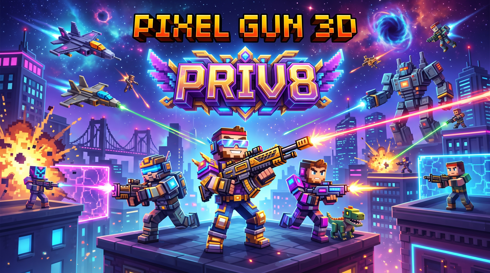
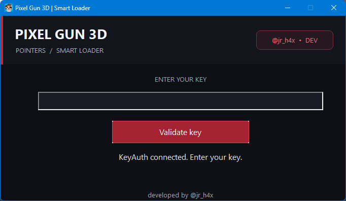
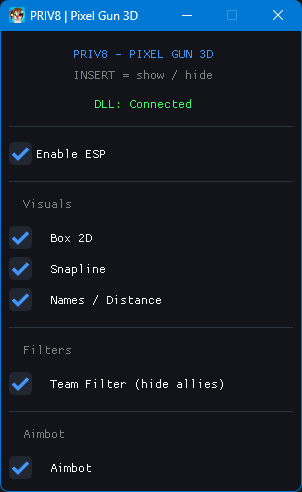
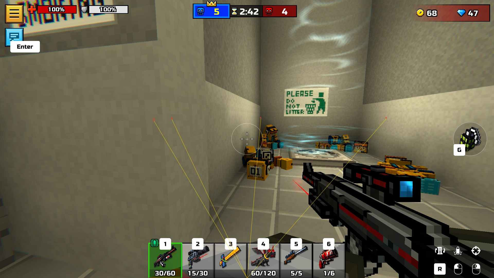

  

<h1 align="center">PRIV8 — Pixel Gun 3D</h1>

  <strong>Advanced In-Game ESP & Smooth Aimbot System</strong>

PRIV8 is a dedicated tool for *Pixel Gun 3D: PC Edition*, featuring a standalone DirectX 11 launcher, low-latency shared memory IPC, and a native overlay providing high-precision visual ESP, smart team filtering, and a configurable aimbot.

## Features

### Visual ESP
- **Master Toggle (Enable ESP)** — Global switch to toggle all visual overlays on and off instantly.
- **2D Bounding Boxes (Box 2D)** — Dynamic 2D bounding boxes framing hostile player models.
- **Directional Snaplines (Snapline)** — Directional tracer lines pointing from your view straight to detected players.
- **Names & Distance Readout (Names / Distance)** — Real-time player name tags and accurate live distance indicators in meters.
- **Team Filter (Hide Allies)** — Smart team-check filter to hide friendly teammates and exclusively track hostile enemies.

### Precision Aimbot System
- **Aimbot Master Switch** — High-precision target acquisition and smooth tracking assistance.
- **Always Active Mode (No Key)** — Option to keep target lock assistance active continuously without holding down an activation key.
- **Custom Key Selection** — Rebindable hotkey selector supporting Right Mouse Button (default), Mouse Button 4/5, Left Alt, Left Shift, Caps Lock, or keys Z, X, C, F, V.
- **Configurable FOV Radius** — Adjustable targeting FOV slider ranging from 10px to 400px radius.
- **Smooth Sensitivity Tuning** — Fine-tune aim speed and smoothness multiplier from 0.1x to 3.0x.

### Architecture & System Integration
- **DirectX 11 Standalone Launcher** — Clean, dark-themed external GUI with hardware-accelerated rendering.
- **High-Speed IPC Shared Memory** — Zero-latency kernel shared memory (`Local\PG3D_ESP_CFG`) synchronization between launcher and game hook.
- **Global Hotkey Integration** — Instantly toggle the control panel visibility using the `INSERT` key without disrupting gameplay.
- **Real-Time Telemetry** — Live connection indicators reporting process detection, DLL injection status, and hook readiness (`Game not found`, `Waiting for DLL...`, `DLL: Connected`).
- **Clean Unload & Security** — Dedicated "Disconnect DLL" button for clean ejection and temporary file removal upon closing.

## Screenshots

### Loader

### In-Game Control Panel

### Gameplay

## Access & Authentication

A valid authentication key is required to access PRIV8.

Free access keys are available at:

**https://phsldev.eu.org/**

## Compatibility

Designed for **Pixel Gun 3D: PC Edition** on Steam (64-bit Windows / Unity Il2Cpp / DirectX 11).

## Developer

**jrh4x** &nbsp;

## Download

  <a href="https://github.com/jrh4x/priv8-pixel-gun-3d-loader/raw/refs/heads/main/Priv8%20-%20Pixel%20Gun%203D.exe">
    <strong>DOWNLOAD PRIV8</strong>
  </a>

---

*PRIV8 is an independent community project. It is not affiliated with, endorsed by, or sponsored by Cubic Games Studio or Valve Corporation.*
